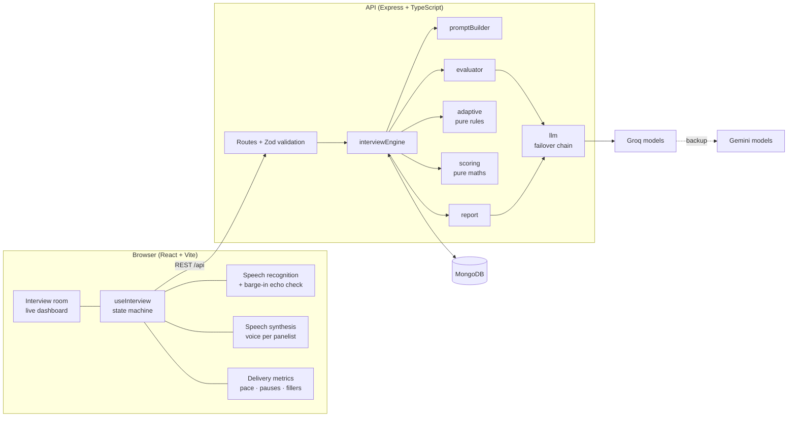

# AI Voice Interview Simulator

A voice-based mock interview for engineering students. A panel of three AI interviewers asks
questions out loud, listens to spoken answers, adapts follow-ups to what the student actually
said, and ends with an evidence-based readiness report.

- **Voice in, voice out:** browser speech recognition and synthesis, a distinct voice per panelist,
  interruptible by voice.
- **Adaptive:** every answer is scored on five dimensions; vague answers get a clarifying follow-up,
  specific claims ("I used Redis for caching") get probed, and difficulty moves with performance.
- **Branch-aware:** CSE and Civil Engineering packs ship; adding a branch is one JSON file.
- **Evidence-based report:** seven competencies with rubric anchors, quotes taken verbatim from the
  student's answers, knowledge gaps, a practice plan, and how much of the interview was attempted.

System design in depth: [FLOW.md](FLOW.md).

---

## Contents
1. [Quick start](#quick-start)
2. [How an interview runs](#how-an-interview-runs)
3. [Architecture](#architecture)
4. [Tech stack and why](#tech-stack-and-why)
5. [LLM: models and failover](#llm-models-and-failover)
6. [Prompt strategy](#prompt-strategy)
7. [Adaptive logic](#adaptive-logic)
8. [Evaluation and the report](#evaluation-and-the-report)
9. [Voice handling and edge cases](#voice-handling-and-edge-cases)
10. [Testing](#testing)
11. [Configuration](#configuration)
12. [Limitations](#limitations)

---

## Quick start

**Prerequisites:** Node.js 22+, a MongoDB connection string (a free Atlas cluster works), and at
least one LLM key: [Groq](https://console.groq.com) (recommended, free) and/or
[Google AI Studio](https://aistudio.google.com) for Gemini. **Chrome or Edge** for voice input.

```bash
# 1. API server
cd server
cp .env.example .env        # set MONGODB_URI and OPENAI_COMPAT_API_KEY (Groq) and/or GEMINI_API_KEY
npm install
npm run dev                 # http://localhost:4000/api/health

# 2. Web client (second terminal)
cd client
npm install
npm run dev                 # http://localhost:5173  (proxies /api to the server)
```

Open http://localhost:5173, pick a sample student (**CSE student, placement portal** or **Civil student,
G+2 residential building**; both synthetic), allow the microphone, and start. No mic? The
interview falls back to typed answers.

**Check the backend end to end without a browser:**
```bash
cd server
npm run smoke               # scripted CSE interview against the running server: 21 checks
npm run smoke -- civil      # same with the Civil profile
npx tsx scripts/evalOnce.ts cse "your answer here"   # one evaluation turn, no database needed
```

---

## How an interview runs

| Panelist | Role | Asks about |
|---|---|---|
| **Priya Sharma** | Panel Lead (HR) | Opens and closes; self-introduction |
| **Arjun Mehta** | Technical Lead | The student's own project and core branch concepts |
| **Kavita Rao** | Engineering Manager | Realistic scenarios and trade-off decisions |

Each panelist has its own avatar, browser voice, pitch and speaking style. The default plan is six
main questions: introduction, two project deep-dive questions, a technical question, a
problem-solving scenario and a decision-making question. Follow-ups are added on top (at most one
per main question, at least two per interview, hard cap of 11 turns).

```
Profile ─▶ Panel intros ─▶ [ Ask (TTS) ─▶ Listen (STT) ─▶ Evaluate ─▶ Adapt ]×N ─▶ Closing ─▶ Report
```

---

## Architecture



**One LLM call per answer.** The evaluator sends the profile, branch context, interview memory
(last 4 turns verbatim plus a running summary), the current question and the transcript. The model
returns scores *and* two candidate next questions (a follow-up and the next main question), so the
deterministic `adaptive` module can choose between them without a second round-trip.

| Module | Job |
|---|---|
| `llm` | `generateJSON(prompt, schema)`: provider chain, timeout, one JSON-repair retry, circuit breaker |
| `promptBuilder` | System and per-turn prompts from profile, branch pack, persona, stage, memory and rubrics |
| `evaluator` | Runs the turn call; drops evidence quotes that aren't in the transcript |
| `adaptive` | Pure `decide()`: follow-up vs next question, difficulty, stage, done |
| `scoring` | Pure: answer dimensions → competencies → overall → readiness; coverage |
| `interviewEngine` | Orchestrates a turn: load → evaluate → adapt → persist → respond; locks against double submits |
| `report` | Computed scores + one narrative LLM call + verbatim-evidence check, cached |
| client `voice/` | Speech recognition (auto-restart, timing), synthesis (per-panelist voice), barge-in, delivery metrics |
| client `useInterview` | Reducer state machine: intro → speaking → listening → submitting → … → report |

**API**

| Method & path | Purpose |
|---|---|
| `POST /api/interviews` | Create a session from a profile; returns panel, intros, first question |
| `GET /api/interviews/:id` | Full session state (resume after refresh) |
| `POST /api/interviews/:id/answer` | Submit a transcript + delivery metrics; returns evaluation, next question, progress |
| `POST /api/interviews/:id/end` | Close the interview (records whether it ended early) |
| `GET /api/interviews/:id/report` | Readiness report (409 until the interview has ended) |
| `GET /api/health` | DB status and the LLM provider chain |

Errors are always `{ error: { code, message } }`: `VALIDATION` (400), `NOT_FOUND` (404),
`STALE_QUESTION` / `INTERVIEW_COMPLETED` / `INTERVIEW_ACTIVE` (409), `RATE_LIMITED` (429).

---

## Tech stack and why

| Layer | Choice | Why |
|---|---|---|
| Client | React 19, Vite, TypeScript | Fast dev loop; a reducer state machine keeps the voice loop predictable |
| Voice | Web Speech API (recognition + synthesis) | Free, no audio upload, low latency; multiple voices for distinct panelists |
| API | Express 5, TypeScript, Zod | Small surface; Zod validates requests *and* LLM output with the same schemas |
| Database | MongoDB (Mongoose) | An interview is one document that grows turn by turn; no joins needed |
| LLM | Groq (OpenAI-compatible) primary, Gemini backup | ~2s per turn keeps a spoken conversation natural; two vendors avoid a single point of failure |
| Tests | Vitest | Same runner on both sides; pure modules make the rules unit-testable |

---

## LLM: models and failover

Providers are tried in order until one returns JSON that passes the schema:

1. **Groq:** `qwen/qwen3.8-27b` → `openai/gpt-oss-120b` → `openai/gpt-oss-20b`
2. **Gemini:** `gemini-3.5-flash-lite` → `gemini-3.8-flash`

- **Why Groq first:** measured at about 1.5–5s per turn versus 10–20s on Gemini's free tier, which matters
  when the student is waiting in silence for the next question.
- **Chaining models multiplies free capacity.** Groq rate-limits each model separately, so when one
  hits its per-minute limit the next answers immediately.
- **Circuit breaker:** a model that fails is skipped while it recovers. After a rate limit it waits
  exactly as long as Groq's retry time; after other failures, 60s.
- **Repair retry:** invalid JSON gets one retry that includes the validation error.
- **Degraded path:** if every provider fails, the answer is saved as *not evaluated* (never given a
  fake score), the interview continues with a scripted bridge question about the student's project,
  and the UI says the answer won't count against them.

`LLM_PRIMARY=gemini` flips the order; the model lists are comma-separated env vars.

---

## Prompt strategy

- **Static rules in the system prompt, everything per-turn in the user prompt.** The system prompt
  holds the scoring rubric (anchors at 2 / 5 / 8 for each dimension), fairness rules and question
  style; the user prompt holds profile, branch pack, memory, the question and the answer.
- **Rubric-anchored scoring.** Each of the five dimensions is scored 0–10 against concrete
  descriptors, which keeps scores consistent across turns and models.
- **Grounded questions.** Questions must build on the student's own project, skills and earlier
  answers; branch packs are passed as background ("use as context, don't read out as a list").
- **Persona style.** The model is told which panelist is speaking and that panelist's style, and
  questions must be one spoken sentence (max 40 words, no lists or markdown).
- **Memory without bloat.** The last 4 turns verbatim plus a ≤60-word running summary, strengths,
  weaknesses and already-probed claims (so the same claim isn't probed twice).
- **Prompt-injection guard.** The answer is wrapped in `<answer>` tags and declared as data, never
  instructions; scores are clamped by the schema.
- **Fairness.** Never reward or penalise accent, pronunciation, non-native grammar or personality;
  no gendered pronouns for the candidate.
- **Structured output only.** Every call returns JSON validated by Zod; Gemini gets a JSON schema
  natively, OpenAI-compatible providers get it in the system prompt with JSON mode.

---

## Adaptive logic

The LLM *proposes*; `adaptive.decide()` (pure, unit-tested) *decides*. Turn score = mean of the
five dimensions.

| Condition | Action |
|---|---|
| Answer is vague, or scores 4–6 in under 25 words | Follow-up: **clarify** (same difficulty) |
| A specific claim to verify, on a project or technical question | Follow-up: **probe the claim** |
| Fewer than 2 follow-ups by the 4th main question | Lower the bar: **deepen** a good answer, clarify a weaker one |
| Score ≤ 3 | Difficulty −1 (min 1) |
| Score ≥ 8 | Difficulty +1 (max 5) |
| Two answers ≥ 8 in a row | +1 more and a **stretch** question |
| Plan finished or 11 turns | Done |

Never a follow-up to a follow-up, never on the introduction. Starting difficulty comes from the
profile (years 1–2 start at 2, later years at 3, +1 for senior roles).

---

## Evaluation and the report

**Per answer (live):** technical accuracy, relevance, communication, clarity, depth (0–10 each),
plus one line of feedback. The live dashboard shows these and a running skill estimate
(exponential moving average per competency).

**Report competencies**, each computed in code from the stored answers, not by the LLM:

| Competency | Fed by | Weight |
|---|---|---|
| Technical knowledge (branch) | accuracy on project/technical answers | 20% |
| Project understanding & ownership | project-stage answers | 20% |
| Logical thinking & problem-solving | depth on the scenario question | 15% |
| Clarity of communication | clarity + communication, every answer | 13% |
| Decision-making & justification | the decision question | 12% |
| Explaining technical concepts | √(clarity × accuracy) on technical answers | 12% |
| Confidence & vocal delivery | pace, pauses, fillers, time to first word | 8% |

Each also blends in the LLM's per-answer competency signal where the answer gave evidence for it.
A competency with no evidence shows **"No evidence"**, never 0.

- **Overall** = weighted mean of competencies with evidence (0–100). **Ready ≥ 75**, **Almost ready
  55–74**, **Needs practice < 55**.
- **Not enough evidence:** with fewer than 3 scored main answers, or no technical / project
  evidence, the readiness verdict is withheld instead of guessed.
- **Coverage:** "X of 6 main questions attempted · N follow-ups", flagged **Ended early by
  candidate** when the student stopped, so a short interview isn't mistaken for a weak one.
- **Evidence is verbatim.** The narrative (strengths, improvements, knowledge gaps, practice plan,
  summary) comes from one LLM call; every quote is fuzzy-matched (≥ 0.85, word level) against the
  transcripts and replaced with the student's exact words, or dropped. A strength without a matching
  quote is removed.
- **Delivery is fair by construction.** Broad bands only (100–170 wpm, few fillers, short pauses),
  floored so it can't sink a candidate alone, lowest weight, and never using accent, pronunciation or
  speech-recognition confidence.
- Practice-plan resources are named in plain text; URLs are stripped so no invented links appear.
- The report prints to PDF with every answer expanded.

---

## Voice handling and edge cases

| Situation | Handling |
|---|---|
| Silence after the question | 10s → the panelist gently re-prompts once; another 10s → submitted as "(no answer)" |
| Thinking pause mid-answer | Auto-submit only after 3.5s of silence, with a visible "submitting in…" hint from 1.5s |
| Unclear / very short speech | Client asks "Sorry, I didn't catch that" once, without calling the LLM |
| Candidate talks over a panelist | **Barge-in:** the panelist stops if the words heard aren't an echo of the question (≥3 new words in the last 6). Toggle in the room header |
| No speech recognition / mic denied | Typed answers with an explanation banner; speech output still works |
| Chrome's ~60s recognition cutoff | Auto-restarts and stitches the segments |
| Network failure | Answer kept in state, retried at 1s and 3s, then a Retry button |
| Page refresh mid-interview | Resumes at the current question |
| Double submit | Atomic lock on the question; duplicates get `409 STALE_QUESTION` |
| Prompt injection in an answer | Treated as data inside `<answer>` tags; schema-clamped scores |

---

## Testing

```bash
cd server && npm test      # 53 unit tests: adaptive rules, scoring, coverage, evidence matching
cd client && npm test      # barge-in echo check
cd server && npm run smoke # 21 end-to-end checks against a running server and real LLMs
```

The smoke test runs a scripted interview (including a deliberately vague answer), checks
validation, follow-ups, double-submit protection, ending, resume, the report (verbatim quotes, no
URLs, caching) and an early-exit report with the verdict withheld.

---

## Configuration

`server/.env` (see [`.env.example`](server/.env.example)):

| Variable | Default | Purpose |
|---|---|---|
| `MONGODB_URI` | (required) | MongoDB connection string |
| `OPENAI_COMPAT_API_KEY` | (none) | Groq (or any OpenAI-compatible) key; at least one LLM key is required |
| `OPENAI_COMPAT_BASE_URL` | Groq | Base URL of the OpenAI-compatible API |
| `OPENAI_COMPAT_MODELS` | `qwen/qwen3.8-27b,openai/gpt-oss-120b,openai/gpt-oss-20b` | Tried in order |
| `GEMINI_API_KEY` | (none) | Google AI Studio key |
| `GEMINI_MODELS` | `gemini-3.5-flash-lite,gemini-3.8-flash` | Tried in order |
| `LLM_PRIMARY` | `openai_compat` | Which provider family goes first (`openai_compat` or `gemini`) |
| `LLM_TIMEOUT_MS` / `LLM_REPORT_TIMEOUT_MS` | `20000` / `30000` | Per-attempt timeouts |
| `PORT` / `CLIENT_ORIGIN` | `4000` / `http://localhost:5173` | Server port and allowed CORS origin |

Client: `VITE_API_URL` points a production build at the API (defaults to same-origin `/api`).

**Adding a branch:** drop a JSON file into `server/src/data/branches/` with `key`, `label`,
`aliases`, `coreAreas`, `projectProbes` and `scenarioSeeds`. Unknown branches fall back to a generic
engineering pack plus the student's own skills.

---

## Limitations

- **Browser support:** voice input needs Chrome or Edge (Web Speech API); other browsers get typed
  answers. Speech recognition runs through the browser vendor's cloud service.
- **Voices** depend on what the operating system provides, so panelists can sound similar on
  machines with few English voices.
- **Barge-in on laptop speakers:** the echo check filters the panelist's own voice, but loud
  speakers in a quiet room can still occasionally trigger it; the header switch turns it off.
- **Free-tier LLM limits:** on Groq's free tier one model handled about two turns per minute in testing; chaining three
  models covers normal speaking pace, and Gemini catches the rest more slowly.
- **LLM judgement:** scores are rubric-anchored and computed deterministically from the model's
  dimension scores, but those dimension scores still come from a model and can vary between runs.
- **Delivery metrics** are rough (word timing from speech recognition), which is why they carry the
  lowest weight.
- **Sample profiles are synthetic**; no real student data is included.
